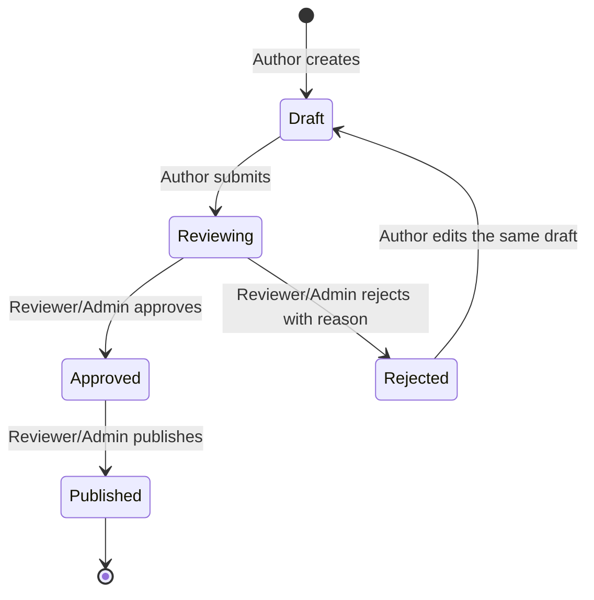

# Business Workflow - Document Review and Publish

**Status:** Business rules aligned with the current requirements and user stories. Unverified implementation coverage is marked explicitly below.

## User value and scope

Authors need a controlled way to submit knowledge for review; Reviewers and Admins need to decide whether a draft is acceptable; Readers need to find only published, current content. A draft must never become an official version merely because it was saved, submitted, approved, or rejected.

In scope: create and edit a draft, submit it for review, approve or reject it, publish an approved draft, maintain the current official version, and make only published current content available to Search and AI.

Out of scope: AI approval, publishing without review, public or Internet sources, and changing the approved versioning or retention policy.

## State model

`Published` is the document's business status after a successful publish. The official version is created at that transition; it is not a separate draft state. For an already-published document, creating a subsequent draft must follow the same review and publish gates. The precise UI/API operation for starting that next draft must be confirmed against the implementation before it is considered accepted.

## Transition rules

| From | Action / actor | Preconditions | To | Required business effect |
| --- | --- | --- | --- | --- |
| None | Create / Author | Required document fields are valid | `Draft` | Save a draft; do not create an official version. |
| `Draft` or `Rejected` | Submit for Review / Author | Caller may edit; no active duplicate request for this draft | `Reviewing` | Create one pending Review Request linked to the document, draft and submitter. |
| `Reviewing` | Approve / Reviewer or Admin | Review Request is pending | `Approved` | Record reviewer and decision time; do not create or advance an official version. |
| `Reviewing` | Reject / Reviewer or Admin | Review Request is pending; a reason is supplied | `Rejected` | Record reviewer, reason and decision time; keep the same draft available to its Author. |
| `Rejected` | Edit / Author | Caller owns or may edit the draft | `Draft` | Update the same draft; do not create an official version. |
| `Approved` | Publish / Reviewer or Admin | Draft has a valid approval and has not already been published | `Published` | Create the next official version, mark it current, and make the prior version non-current. |
| Any other state | Invalid action | Transition is not listed above or caller lacks permission | No change | Return an explicit authorization or state-conflict error; do not partially apply the command. |

## Invariants and business rules

1. Only a Reviewer or Admin may approve, reject or publish. An Author may not approve, reject or publish their own draft.
2. Only a pending review may be decided. A reject decision requires a reason.
3. A draft cannot be published before approval, after rejection, or while review is pending.
4. Save, submit, approve, reject, edit and resubmit do not create an official version. Publish after approval is the only version-creation event.
5. Rejection preserves the draft. Editing and resubmitting it must not create a new official version or lose its document identity.
6. Each published document has exactly one current official version. Search and Q&A use only current published versions.
7. View permission is required at every surface that can reveal a document: direct read, search result, AI retrieval and citation.
8. A retry must not create duplicate review requests or publish the same draft twice.

## Acceptance criteria for the end-to-end workflow

- **Given** an Author creates a document, **when** it is saved, **then** it is `Draft` and has no official version.
- **Given** an editable draft, **when** its Author submits it, **then** it becomes `Reviewing` and exactly one pending request references the same document, draft and submitter.
- **Given** a pending request, **when** an authorized Reviewer or Admin approves it, **then** it becomes `Approved`, records who and when, and still has no new official version.
- **Given** a pending request, **when** an authorized Reviewer or Admin rejects it without a reason, **then** the command is rejected; with a reason, the draft becomes `Rejected` and remains editable by its Author.
- **Given** a rejected draft, **when** its Author edits and resubmits it, **then** it is the same draft and no official version has been added.
- **Given** a draft that is not approved, **when** anyone attempts to publish it, **then** the system rejects the command and leaves the document unchanged.
- **Given** an approved draft, **when** a Reviewer or Admin publishes it, **then** exactly one next official version is created and becomes the sole current version.
- **Given** a later official version is published, **when** Search or AI retrieves the document, **then** only the current published version can be returned, subject to the caller's view permission.

## Requirement and backlog links

- Requirements: [REQ-FR-02 through REQ-FR-11](../02-requirements/requirements.md), [REQ-BR-01, REQ-BR-03 and REQ-BR-05](../02-requirements/requirements.md).
- Stories: [US-AI-03 and US-AI-05 through US-AI-08](../04-backlog/user-stories.md).
- Product flow: [user-flow.md](user-flow.md); UI states: [states.md](../05-design/states.md).
- API design: [api-contract.md](../06-technical/api-contract.md).
- Test case inventory: [test-cases.md](../07-testing/test-cases.md).

## Implementation and test evidence

Current backend routes include `POST /api/documents`, `PATCH /api/documents/{document_id}`, `POST /api/documents/{document_id}/review`, `GET /api/reviews`, `POST /api/reviews/{review_id}/{decision}`, and `POST /api/documents/{document_id}/publish`.

Automated evidence currently includes `backend/tests/test_api.py::test_document_review_approval_publish_and_version_history` for the happy path and `backend/tests/test_api.py::test_review_rejection_requires_reason_and_inactive_user_cannot_login` for rejection-reason validation. The existing suite does not yet demonstrate every acceptance criterion above (notably reject-edit-resubmit identity, duplicate submit/publish retries, all denied transitions, subsequent published-document drafts, and version-currentness across two publishes). Track those cases in [test-cases.md](../07-testing/test-cases.md); do not report them as passed until automated or approved manual evidence is recorded.

## Decisions / follow-up

- Confirm the supported permission-grant model and document-level visibility rules before approving the permission matrix; role names alone do not define which individual documents each user may read.
- Confirm the product operation for starting a new draft from a published document. The requirement promises a next official version after a subsequent publish, but the route behavior must be verified end to end.
- Add test run, commit and PR links to the traceability matrix when implementation evidence exists.
